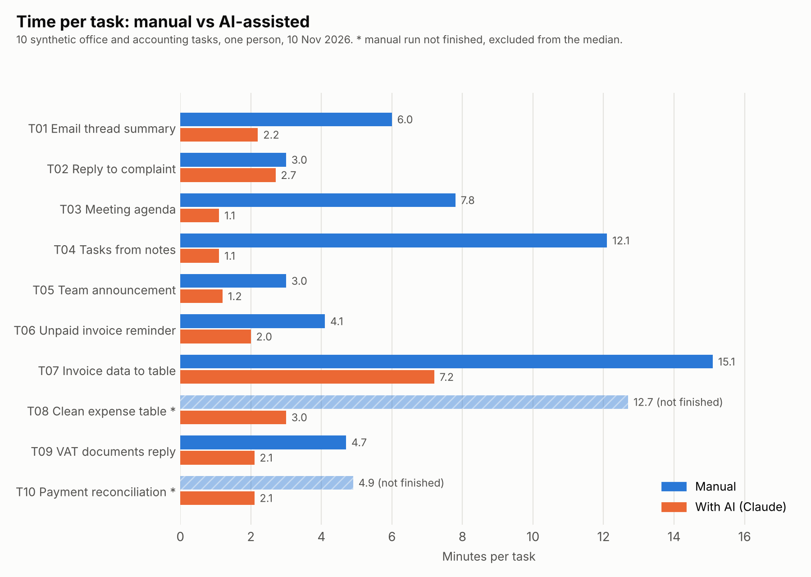

# Time-and-Motion Study: manual work vs AI-assisted work

How much time does an AI assistant really save on office and accounting tasks, and where does it create problems?

Self-directed prototype. Synthetic data.

## Problem

Many people say that AI saves time in the office, but they do not measure it.
I wanted my own numbers for typical tasks of an office and a small accounting firm (gestoría).

## Solution

I prepared 10 tasks: 5 general office tasks and 5 accounting tasks. I did each
task twice, once by hand and once with Claude, and measured the time with a
stopwatch. A reviewer scored 5 pairs of results without knowing which one was
made with AI. Then I checked the facts in every reviewed text against the input data.

## Tools

Claude Fable 5.2 (claude.ai), Google Sheets, phone stopwatch.

## How it works

1. Two input files of the same difficulty for each task (A = manual, B = AI).
2. Timed runs following a written [protocol](docs/protocol.md).
3. Blind quality review with a 5-point checklist.
4. Fact check against the input data.
5. Analysis and [report](docs/report.md).

## Results

| Metric | Manual | With AI |
| --- | --- | --- |
| Median time per task | 5.4 min | 2.1 min |
| Tasks where AI was faster | | 8 of 8 |
| Average quality score, blind review (1-5) | 4.7 | 5.0 |
| Reviewed texts that differ from the input data | 5 of 5 | 1 of 5 |

Test size: 8 tasks for time (2 manual runs were not finished), 5 task pairs for
quality. One person, 10 November 2026, Claude Fable 5.2 (claude.ai chat, medium setting).

Main findings:

- AI was faster on every finished task, but for a short reply the time was almost the same.
- The only AI error in the reviewed texts came from a wrong date in my own prompt.
- The reviewer missed all factual errors. Numbers and dates need a separate check.

Full details: [docs/report.md](docs/report.md).

## Limitations

Small sample, one person, one day, synthetic tasks, one reviewer. Two manual
runs were not finished and three manual texts were not saved. The results show
a tendency, not a rule. See the Limitations section in the report.

## Files

- `docs/` - protocol and report
- `data/inputs/` - synthetic input data (Spanish)
- `data/outputs/` - the 10 reviewed results (manual and AI)
- `data/results.csv` - time measurements
- `data/quality_review.csv` - reviewer scores
- `images/` - chart

## About

Olga Sorokina - AI automation for accounting and office workflows. Málaga, Spain.
