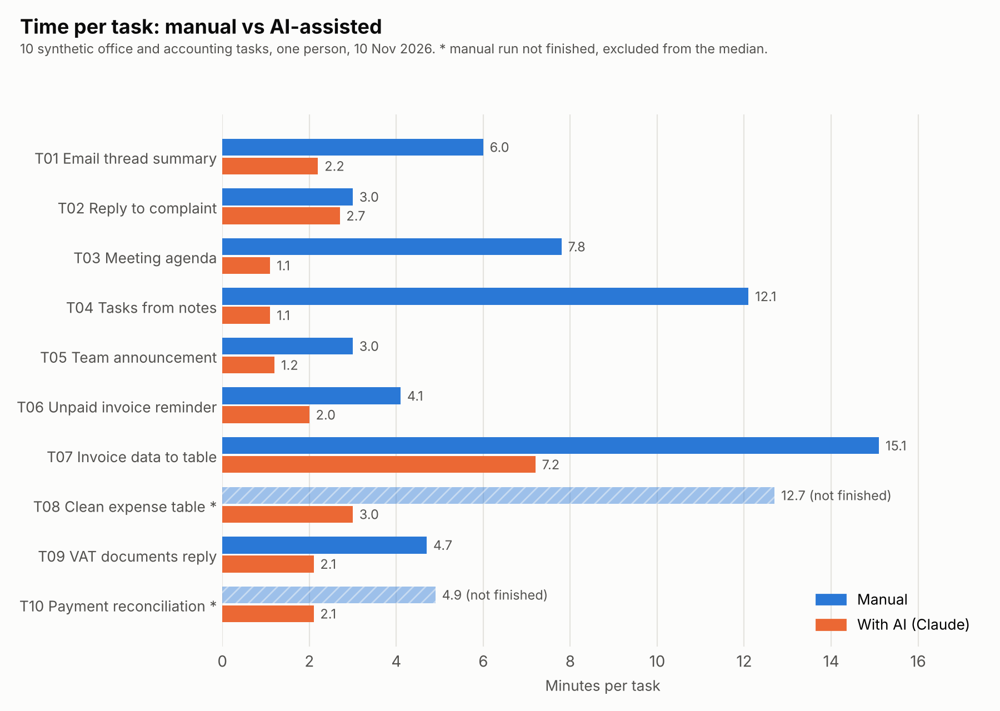

# Report: manual work vs AI-assisted work

## Goal

I wanted to know how much time an AI assistant really saves on everyday office
and accounting tasks, and where it creates new problems.

## Method

- 10 tasks: 5 general office tasks (T01-T05) and 5 accounting tasks (T06-T10).
- Each task has two input files of the same difficulty: version A for the
  manual run and version B for the AI run. All input data is synthetic and in Spanish.
- I did every task twice: once without AI and once with Claude Fable 5.2 (claude.ai chat, medium setting).
- I measured time with a phone stopwatch. Time in the AI run includes writing
  the prompt and editing the answer.
- Test date: 10 November 2026. One person did all runs.
- Quality: one reviewer scored 5 task pairs (10 texts) on five points from 1 to 5.
  The reviewer did not know which text was manual and which was made with AI.
- After the review I compared every reviewed text with its input data (fact check).

The full rules are in [protocol.md](protocol.md).

## Results

### Time

| Metric | Manual | With AI |
| --- | --- | --- |
| Median time per task (n = 8 tasks) | 5.4 min | 2.1 min |
| Total time for 8 tasks | 55.8 min | 19.6 min |
| Tasks where AI was faster | | 8 of 8 |

Two manual runs (T08 and T10) were not finished, so they are not in these numbers.
In my test, the median time with AI was about 61% lower than the manual time.

| Task | Manual (min) | With AI (min) | Change |
| --- | --- | --- | --- |
| T01 Email thread summary | 6.0 | 2.2 | -63% |
| T02 Reply to complaint | 3.0 | 2.7 | -10% |
| T03 Meeting agenda | 7.8 | 1.1 | -86% |
| T04 Tasks from notes | 12.1 | 1.1 | -91% |
| T05 Team announcement | 3.0 | 1.2 | -60% |
| T06 Unpaid invoice reminder | 4.1 | 2.0 | -51% |
| T07 Invoice data to table | 15.1 | 7.2 | -52% |
| T08 Clean expense table | 12.7 (not finished) | 3.0 | not compared |
| T09 VAT documents reply | 4.7 | 2.1 | -55% |
| T10 Payment reconciliation | 4.9 (not finished) | 2.1 | not compared |

### Quality (blind review, 5 task pairs)

| Task | Manual | With AI |
| --- | --- | --- |
| T01 Email thread summary | 4.4 | 5.0 |
| T02 Reply to complaint | 4.4 | 5.0 |
| T03 Meeting agenda | 4.8 | 5.0 |
| T05 Team announcement | 5.0 | 4.8 |
| T07 Invoice data to table | 5.0 | 5.0 |
| Average | 4.7 | 5.0 |

The reviewer's comments were mostly about tone: some manual texts were
"too short and not formal enough", and one AI text was "too formal".

### Fact check against the input data

The reviewer gave 5 of 5 for accuracy to all ten texts. My own check found
differences that the reviewer did not see:

| Text | Differences from the input data |
| --- | --- |
| T01 manual | wrong number of chairs (16, not 24), wrong month, deadline for the answer is missing |
| T02 manual | wrong reason for the delay, the 10% discount is missing |
| T03 manual | wrong month, company names and prices that are not in the input |
| T05 manual | wrong dates and working hours, the sign-up step is missing |
| T07 manual | invoice numbers are replaced with "Factura 1, 2, 3" |
| T02 AI | wrong date (14 June, not 22 June). The wrong date came from my prompt |
| T01, T03, T05, T07 AI | no differences found |

## Findings

1. **AI saved time on every finished task, but not equally.** The biggest
   savings were on structured writing (agenda, task list). For a short reply to
   a complaint (T02) the time was almost the same, because writing the prompt
   took as long as writing the answer.
2. **Under time pressure, my manual texts had more factual errors than the AI
   texts.** The only AI error in the reviewed texts came from a wrong date in
   my own prompt. AI repeats the mistakes you give it.
3. **A human reviewer is not enough for numbers and dates.** The reviewer
   noticed tone but missed all factual errors. Facts need a separate check
   against the source.
4. **Tables cost extra time.** In T07 and T08 the AI answer was correct, but I
   could not copy it as a table, so I moved the data by hand. This is why T07
   was the slowest AI task (7.2 min).

## Limitations

- Small sample: 10 tasks, one person, one day. The results show a tendency, not a rule.
- The protocol planned 2 tasks per day. I did all runs on one day, so I was
  tired at the end and I knew the task type in the second run.
- Two manual runs (T08, T10) were not finished and are excluded from the time comparison.
- The manual texts for T04, T06 and T09 were not saved, so quality was reviewed
  for 5 of 10 tasks only.
- One reviewer, a family member with near-native Spanish. The review was blind
  but not independent.
- I did not count manual edits during the runs. The numbers in `manual_edits`
  come from my notes and exist for 5 tasks only.
- The saved AI texts are the answers before my last small edits (for example,
  adding a name or a date).
- I tested one model only (Claude Fable 5.2). Results can change with another model or a newer version.
- All tasks are synthetic and simple. Real office work has more context.

## Recommendations

- Use AI for first drafts of structured texts: agendas, task lists, summaries,
  standard emails.
- For very short messages, writing by hand can be just as fast.
- Always check numbers, dates and names against the source, in manual work and in AI work.
- Check the prompt before sending it: a wrong fact in the prompt becomes a wrong fact in the answer.
- Ask the AI for a table format that can be copied (for example CSV) when the result goes to a spreadsheet.
